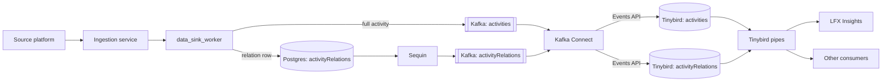
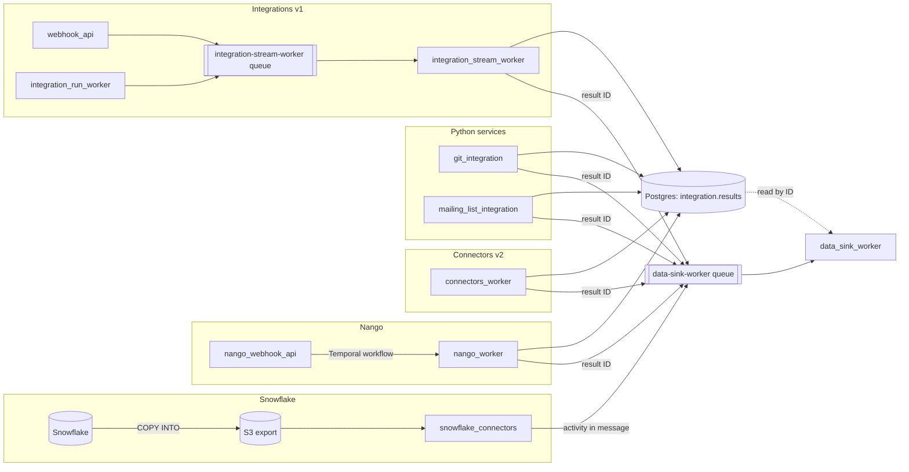
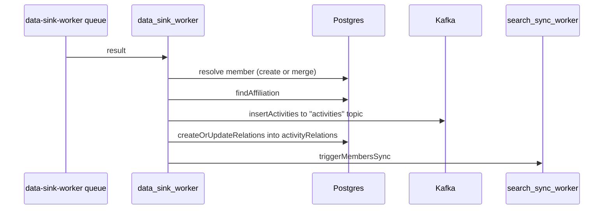

# Activity pipeline

How an activity travels from a source platform to Tinybird and LFX Insights. The text map,
with the code paths and troubleshooting steps, is in
[`docs/knowledge/data-flow.md`](../knowledge/data-flow.md). This doc holds the pictures.

## End to end

Every ingestion path hands its results to `data_sink_worker`. The data sink splits each activity
in two, and the halves reach Tinybird by different routes: the full activity goes straight to a
Kafka topic, and the relation row goes through Postgres and Sequin. Kafka Connect forwards both
topics to the Tinybird Events API, which lands each topic in the datasource of the same name.

Sequin replicates other Postgres tables the same way, such as `members`, `organizations` and
`insightsProjects`. What happens inside Tinybird, the deduplication, enrichment and bucketing, is
library-internal and documented in `services/libs/tinybird/`:

- [`dataflow.md`](../../services/libs/tinybird/dataflow.md): system diagram, including the
  Snowflake branch
- [`lambda-architecture.md`](../../services/libs/tinybird/lambda-architecture.md) and
  [`bucketing-architecture.md`](../../services/libs/tinybird/bucketing-architecture.md): the two
  `activityRelations` architectures

## Ingestion paths

Each path reaches the data sink through the `data-sink-worker` Kafka queue. Most paths first
write the raw result to the Postgres table `integration.results` and send only its ID;
`data_sink_worker` reads the result back from that table. `snowflake_connectors` sends the
activity inside the queue message instead.

In production, `cron_service` runs `integrationResultsCheck` every 10 minutes. When the
`data-sink-worker` queue runs low and `integration.results` still holds pending results, it
re-queues the pending result IDs.

## Inside the data sink

For each batch, `data_sink_worker` resolves members and organizations before it writes anything,
then writes the full activity to Kafka before it writes the relation row to Postgres. A failure
between those two writes leaves an activity in Tinybird's `activities` with no relation row in
Postgres yet.

`search_sync_worker` then updates the member in OpenSearch.
