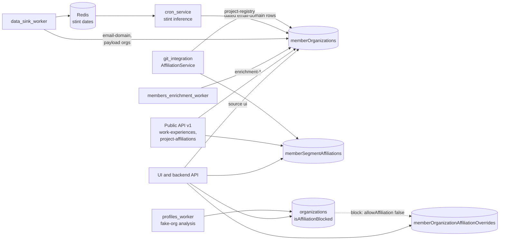
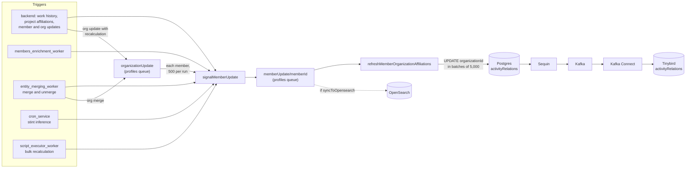
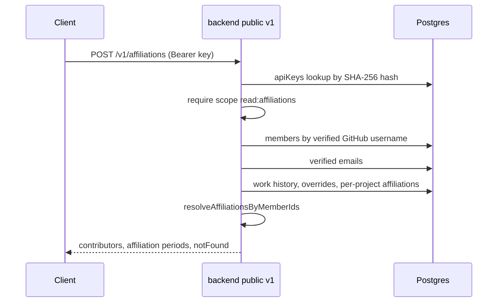
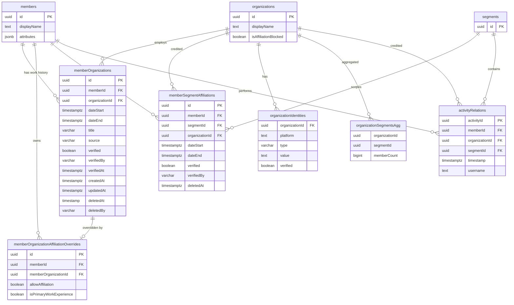

# Affiliation across CDP services and stores

How CDP decides which organization each activity is credited to, and how that decision reaches
Tinybird and the public API. For where each piece lives, start from the note
[`flow-affiliation.md`](../knowledge/flow-affiliation.md).

## Where affiliation data comes from

Four tables feed every decision: work history (`memberOrganizations`), per-project affiliations
(`memberSegmentAffiliations`), per-work-experience overrides
(`memberOrganizationAffiliationOverrides`) and the organization-level block flag
(`organizations.isAffiliationBlocked`). The `source` column on `memberOrganizations` records which
writer created each row.

Blocking an organization, from the UI, from fake-organization analysis or from a script, sets
`allowAffiliation = false` on every work experience at that organization and deletes its
per-project affiliations.

## Recalculation and propagation

A change to any input signals the member's `memberUpdate` workflow. The workflow rebuilds the
member's timeline and rewrites `activityRelations`; Postgres replication carries the change to
Tinybird. The rules each path uses to pick an organization are in
[`member-organization-affiliation/README.md`](../../services/libs/data-access-layer/src/member-organization-affiliation/README.md).

Signals that arrive while a pass is running are merged into one follow-up pass, so a member
never has two recalculations racing.

## Serving affiliations

The public affiliations API does not read `activityRelations`. It rebuilds periods from the same
tables on each request.

## Data model

Only the columns that take part in affiliation are shown.

- `memberOrganizationAffiliationOverrides` is unique on `(memberId, memberOrganizationId)`. A
  missing row, or a `null` value, means `allowAffiliation = true` and
  `isPrimaryWorkExperience = false`.
- `members.attributes` carries the bot flag that makes ingest skip affiliation.
- `activityRelations.username` is what the email-domain rules match on.
