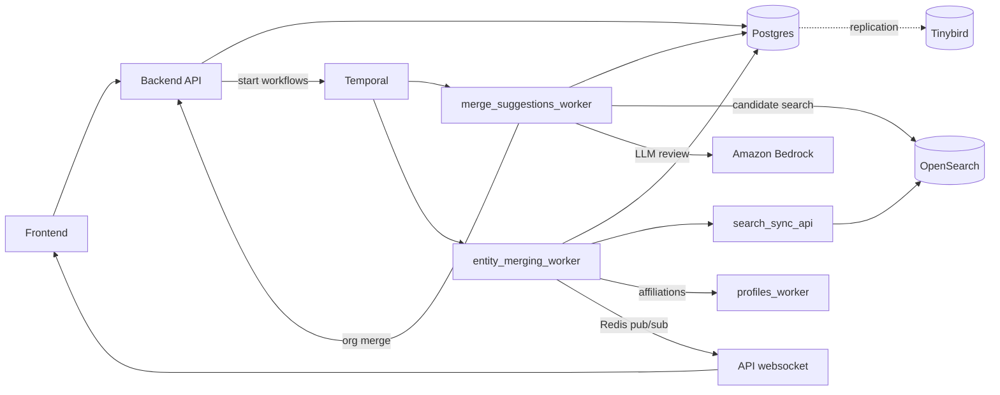
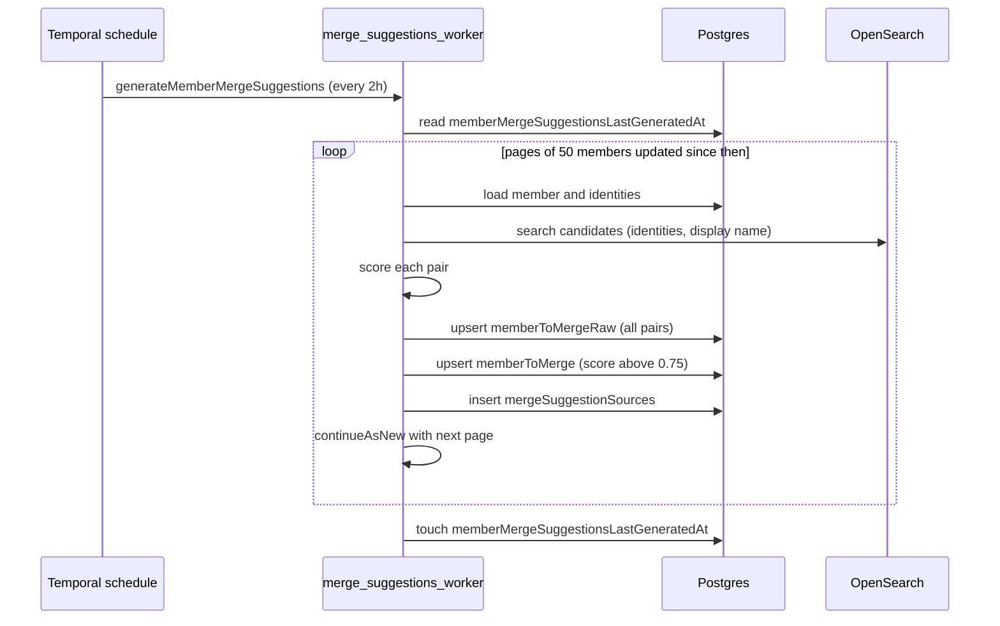
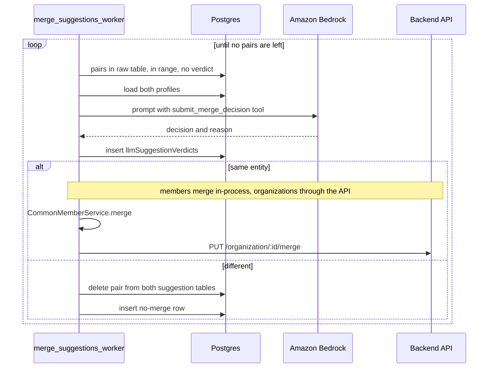
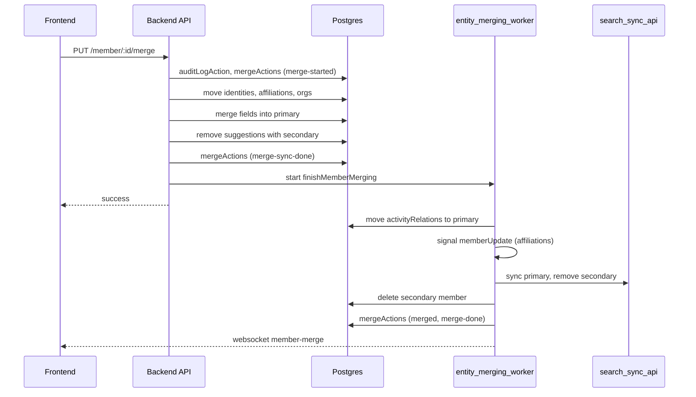
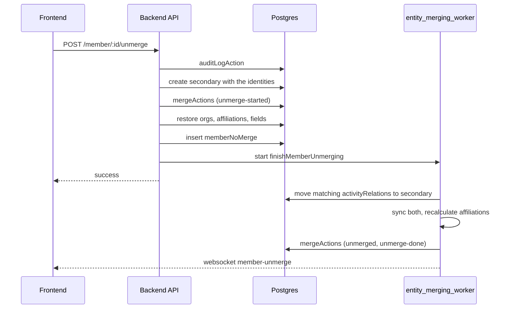
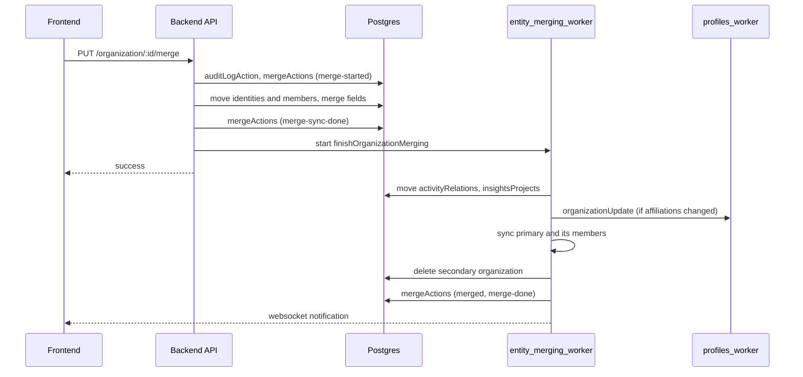

# How deduplication works across services

These diagrams show how CDP finds duplicate members and organizations, decides on them, and
merges or unmerges them. [`flow-deduplication.md`](../knowledge/flow-deduplication.md) lists the
files, tables and workflows by name; the ADRs linked there explain why the flow works this way.

## Components

The API and the two Temporal workers share Postgres. The suggestion generator reads candidates
from OpenSearch, and merges keep that index up to date through `search_sync_api`. Merge and
unmerge rewrite `activityRelations` in Postgres, which replicates to Tinybird.

## Generating suggestions

Two schedules run every two hours, one for members and one for organizations. Each run pages
through records updated since the last run, scores candidates, and stores the pairs. How a pair
is scored is in
[`merge_suggestions_worker/README.md`](../../services/apps/merge_suggestions_worker/README.md). A third,
daily schedule looks for duplicates inside recently onboarded projects
([ADR-0025](../adr/0025-subproject-member-merge-suggestions.md)).

Organizations follow the same sequence with `generateOrganizationMergeSuggestions`, pages of 25,
and the `organization*` tables. Pairs that already have a valid no-merge row are excluded from
the candidate search. In a member pair, the member with more identities becomes the primary; on a
tie, the one with more activities.

## LLM review

`mergeMembersWithLLM` and `mergeOrganizationsWithLLM` are started on demand with a similarity
range. Each run takes a small batch of pairs from the raw table that have no verdict yet, asks a
Claude model on Amazon Bedrock for a structured yes or no, stores the verdict, and acts on it.
The member prompt tells the model never to merge two profiles with different values on the same
platform, never to merge a bot with a human, and never to merge on display name alone. Identities
that look like emails are removed from members before the call.

## Member merge

A person merges from the UI with `PUT /member/:id/merge`; the LLM review calls the same
`CommonMemberService.merge`. The synchronous part runs in one transaction and returns to the
caller. `entity_merging_worker` then does the slow part. Only merges started by a user notify
the UI.

## Member unmerge

Unmerge takes one identity off a member. The caller can either split only that identity into a
new member or, when a merge backup exists, restore both members as they were before the merge
(`revertPreviousMerge`). `POST /member/:id/unmerge/preview` shows the result first.

## Organization merge and unmerge

Organizations follow the same split between a synchronous step in `organizationService.ts` and a
background workflow. The background merge also moves Insights projects to the primary
organization and resyncs every member of the primary organization in OpenSearch.

An organization unmerge restores the secondary organization and its member roles from
`unmergeBackup`, writes `organizationNoMerge`, and starts `finishOrganizationUnmerging`, which
recalculates affiliations and resyncs both organizations.
