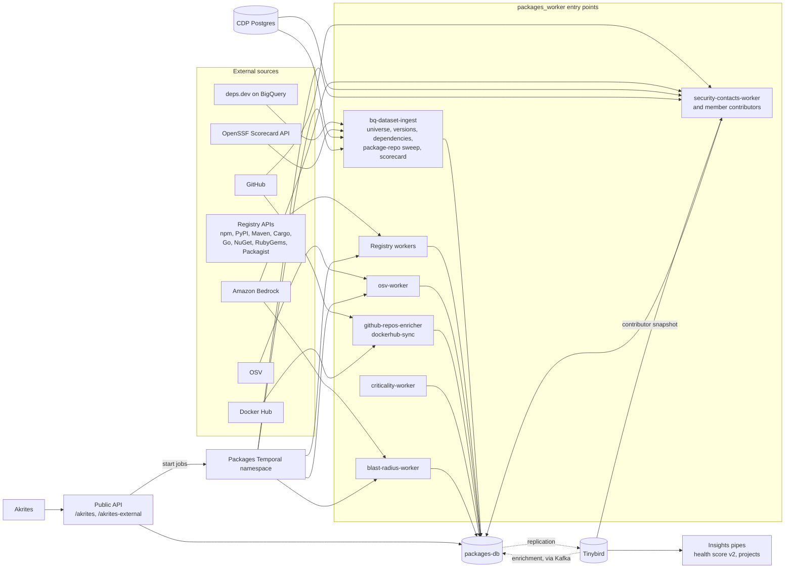
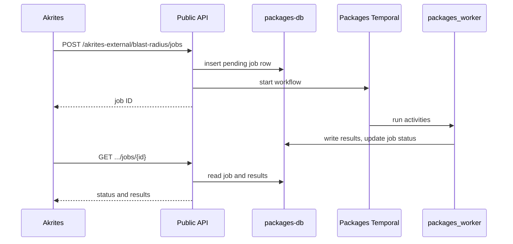

# OSS packages data across services

How the packages workers, `packages-db`, the public API and Tinybird connect. What each part is
and where it lives is in [`docs/knowledge/sys-packages.md`](../knowledge/sys-packages.md); how to
run the workers is in
[`services/apps/packages_worker/README.md`](../../services/apps/packages_worker/README.md).

## Components

Every worker writes to `packages-db`, a Postgres instance separate from the CDP database. Two
entry points also read the CDP database: `bq-dataset-ingest`, whose Scorecard job reads CDP's
GitHub repositories and integrations, and `security-contacts-worker`, which runs the security
contacts jobs and resolves contributors' organizations for member contributors. The public API
reads `packages-db` directly and starts the on-demand jobs in the packages Temporal namespace.
Tinybird gets a replica of the main tables, derives `ossPackages_enriched_ds` from them, and
sends its enrichment fields back to `packages` through Kafka. Tinybird is also an input: the git
activity contributor sync in `security-contacts-worker` reads a commit contributor snapshot from
Tinybird (`CROWD_PACKAGES_TB_TOKEN`) before writing to `packages-db`.

`github-repos-enricher` and `dockerhub-sync` are plain long-running loops, not Temporal workers,
and `criticality-worker` keeps a connection open while ranking runs from scripts and SQL
functions. Schedules and task queues per entry point are listed in the worker README.

## On-demand jobs

Blast radius analyses and member contributor reports are too slow for a request. The API records
the job in `packages-db`, starts a workflow in the packages Temporal namespace, and returns a job
ID that the client polls. The API uses a separate Temporal client for this
(`backend/src/db/packagesTemporal.ts`), because the workers do not poll the API's default
namespace.

Blast radius jobs run `analyzeBlastRadius` on the `blast-radius-worker` task queue. Member
contributor jobs follow the same pattern under
`/akrites-external/packages/member-contributors/jobs` and run on the `security-contacts-worker`
task queue. Unlike blast radius, a member contributor submission does not always
create a job: a package that already has contributors is rejected with 409 unless its last job
failed, a submission while a job is active for the package returns that job, and a workflow that
fails to start marks its job failed (`submitMemberContributorsJob.ts`).

One exception to the read path above: for member contributor jobs that resolve repositories with
an LLM (`collectionPath` `llm_repo_resolution`), polling returns the Temporal workflow result
instead of reading `packages-db`, so a completed job can fail as expired once its workflow history
is gone (`getMemberContributorsJob.ts`).
