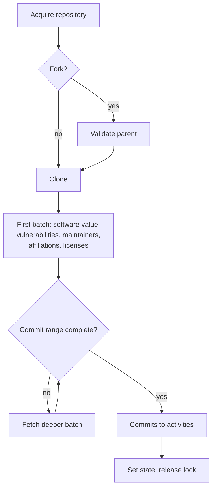

# Git Integration V2

The Git integration is a Python worker service that processes Git repositories to extract
contributor information from commits. Each worker acquires one repository at a time from a
database-backed queue, clones it, runs a set of analysis services on the checkout, turns new
commits into activities, and hands those activities to the data sink through `integration.results`
and Kafka.

For how its output reaches the rest of CDP, see
[Activity pipeline](../../../docs/design/activity-pipeline.md). This README covers the service's
own internals and how to run it.

## Components

The service is a FastAPI app (`src/crowdgit/server.py`) whose lifespan starts one
`RepositoryWorker` loop. `GET /` is a health check. On shutdown the worker stops picking new
repositories and gets up to `WORKER_SHUTDOWN_TIMEOUT_SEC` to finish the current one; after that the
run is cancelled. If the process is killed sooner, for example by a container grace period shorter
than that timeout, the repository keeps its lock and stays in `processing` (see Troubleshooting).

| Component                     | Path                                           | What it does                                                                                                 |
| ----------------------------- | ---------------------------------------------- | ------------------------------------------------------------------------------------------------------------ |
| `RepositoryWorker`            | `src/crowdgit/worker/repository_worker.py`     | Polling loop: acquires a repository, runs the services, sets the final state, releases the lock              |
| `CloneService`                | `src/crowdgit/services/clone/`                 | Picks a full or incremental clone and yields clone batches                                                   |
| `SoftwareValueService`        | `src/crowdgit/services/software_value/`        | Runs the `software-value` Go binary ([README](src/crowdgit/services/software_value/README.md))               |
| `VulnerabilityScannerService` | `src/crowdgit/services/vulnerability_scanner/` | Runs the `vulnerability-scanner` Go binary ([README](src/crowdgit/services/vulnerability_scanner/README.md)) |
| `MaintainerService`           | `src/crowdgit/services/maintainer/`            | Finds and parses maintainer files, keeps `maintainersInternal` in sync                                       |
| `AffiliationService`          | `src/crowdgit/services/affiliation/`           | Parses contributor-to-organization files kept in the repository                                              |
| `LicenseService`              | `src/crowdgit/services/license/`               | Detects SPDX licenses with `licensee`                                                                        |
| `CommitService`               | `src/crowdgit/services/commit/`                | Parses `git log` into activities                                                                             |
| `QueueService`                | `src/crowdgit/services/queue/`                 | Kafka producer for data sink messages                                                                        |
| Database access               | `src/crowdgit/database/crud.py`                | All SQL the service runs                                                                                     |

Maintainer and affiliation parsing call a Claude model on Amazon Bedrock
(`src/crowdgit/services/llm/bedrock.py`).

## Processing a repository



### 1. Acquire

The worker polls every `WORKER_POLLING_INTERVAL_SEC` and backs off `WORKER_ERROR_BACKOFF_SEC`
after a loop error. `acquire_repo_for_processing()` tries three queues in order and locks the
row it picks by setting `lockedAt` (`FOR UPDATE ... SKIP LOCKED`, so workers never share a
repository):

1. **Onboarding**: `state = 'pending'`, ordered by `priority`, then `createdAt`. Skipped when
   `integration.results` holds `MAX_INTEGRATION_RESULTS` rows or more (or the count query fails),
   and when `MAX_CONCURRENT_ONBOARDINGS` repositories without a `lastProcessedCommit` are already
   `processing`.
2. **Pending re-onboard** (Saturday and Sunday UTC only): `state = 'pending_reonboard'`. On
   acquisition the worker clears `lastProcessedCommit` and `branch` and increments
   `reOnboardingCount` in the same statement, so the repository goes through a fresh onboarding.
3. **Recurrent**: any state except `pending`, `processing`, `pending_reonboard` and
   `auth_required`, last processed more than `REPOSITORY_UPDATE_INTERVAL_HOURS` ago (or
   `FAILED_RETRY_INTERVAL_HOURS` for `failed`), ordered by `priority`, then oldest
   `lastProcessedAt`. A hard-coded guard lets only one repository from a rate-limited Gerrit host
   run at a time.

Priorities are `0` urgent, `1` high and `2` normal. New rows default to `1`, and every finished
run resets the repository to `2`. Soft-deleted repositories (`deletedAt` set) are never acquired.

### 2. Fork check

When `forkedFrom` is set, the parent must exist with `state = 'completed'` and have been processed
within `REPOSITORY_UPDATE_INTERVAL_HOURS`. Otherwise the run ends with `requires_parent`. The
parent is used later to drop inherited maintainers and activities.

### 3. Clone

`CloneService.clone_batches_generator()` clones into a temporary directory:

- **Full clone** (`--single-branch --no-tags`) when the repository has no `lastProcessedCommit` or
  its remote default branch differs from the saved `branch`. The first batch is also the final one.
- **Incremental clone** otherwise: a `--depth=1` clone, then `git fetch --deepen` in batches that
  start at 50 commits and double up to 10,000, until `lastProcessedCommit` is present and no
  shallow boundary falls inside `lastProcessedCommit..HEAD`. Gerrit servers that fail on
  `--deepen` get a single `--unshallow` fetch instead.

Clone commands retry rate limits, network and remote 5xx errors three times with exponential
backoff. After each deepening fetch, a checkout larger than 10,000 MB is compacted with `git gc`. When the
first batch has been processed, the working tree is removed (only `.git` stays), and the temporary
directory is deleted at the end of the run.

An incremental clone raises `ReOnboardingRequiredError`, and the run ends with
`pending_reonboard`, when either:

- the clone is no longer shallow but `lastProcessedCommit` is missing (history was rewritten, for
  example by a force push), or
- the time since `lockedAt` exceeds `STUCK_RECURRENT_REPO_TIMEOUT_HOURS`. The code also
  defines `STUCK_ONBOARDING_REPO_TIMEOUT_HOURS` for repositories without a `lastProcessedCommit`,
  but those always take the full-clone path, which returns before the timeout check, so it never
  applies.

### 4. First-batch services

These need the working tree, so they run once, on the first batch, in this order. A failure in one
does not stop the run. Each records its result in `git."serviceExecutions"` except licenses, which
have no operation type there and only write to the logs.

- **Software value** and **vulnerability scanner** run their Go binaries on the checkout. The
  binaries write their results to the database themselves; see their READMEs.
- **Maintainers** run when the interval has elapsed since `lastMaintainerRunAt`:
  `MAINTAINER_UPDATE_INTERVAL_HOURS` if a maintainer file was found last time,
  `MAINTAINER_RETRY_INTERVAL_DAYS` if not. Detection order:
  1. A CNCF `.project` repository uses its `maintainers.yaml` (or `.yml`) directly, without the
     LLM.
  2. A root `INFO.yaml` in the
     [LF Release Engineering format](https://github.com/lfit/releng-global-jjb/blob/master/schema/info-schema.yaml)
     (a `project_lead` and a `committers` list), used by LF-hosted Gerrit projects such as ONAP,
     OpenDaylight, FD.io and O-RAN-SC. It is parsed directly, without the LLM: the project lead
     and every committer are maintainers, and the `tsc` change log is ignored.
  3. The file saved in `maintainerFile`, if it still exists.
  4. Candidate files found by name (`MAINTAINERS`, `CODEOWNERS`, `OWNERS`, `GOVERNANCE.md` and
     similar), scored, then filtered by an LLM classifier. Root-level candidates are parsed first
     and their results combined; otherwise the top subdirectory candidate is tried.
  5. As a last resort, the LLM picks a file from the repository's file list.

  Steps 1 and 2 run before the saved file, so a repository that settled on another file earlier
  (for example `AUTHORS` in a Gerrit repository) switches on its next run.

  Maintainers resolve to verified `memberIdentities` by GitHub username, then by email. The
  service upserts new `(identity, role)` pairs into `maintainersInternal` and sets `endDate` on
  pairs that disappeared from the file. The first run for a repository (no `lastMaintainerRunAt`)
  only inserts; end-dating starts from the second run. A pair whose GitHub username or email is still in the file
  but no longer resolves to a verified identity keeps its open row; it is only end-dated once it
  leaves the file or its identity is deleted. For forks, maintainers already listed on the parent are dropped. In a
  CNCF project that has a `.project` repository, the other repositories skip maintainer extraction,
  and the `.project` file end-dates their maintainer rows.

- **Affiliations** run every `AFFILIATION_UPDATE_INTERVAL_HOURS` once a file is known, or every
  `AFFILIATION_RETRY_INTERVAL_DAYS` while none is, and track the file, its hash and a parsed snapshot in
  `git."repoAffiliationRegistry"`. What the parsed rows mean for affiliation is described in
  [How CDP affiliates activities with organizations](../../../docs/knowledge/flow-affiliation.md).
- **Licenses** run `licensee detect` and write SPDX identifiers with confidence of at least 98 to
  `public.repositories.licenses`. A license file that matches nothing reliably is stored as
  `NOASSERTION`; no license file stores an empty list. A missing binary or a timeout is logged as a warning and stores an empty list. Any other
  non-zero `licensee` exit is logged at info level as "found no license", so it looks exactly like
  a repository without a license file, in the data and in the logs.

### 5. Commits

On the final batch, `CommitService` runs `git log --numstat` over the whole default branch (full
clone) or `lastProcessedCommit..HEAD` (incremental clone). It splits the output into chunks of 250
commits, processes two chunks at a time, and skips commits whose hash, dates or emails fail
validation. Each valid commit produces:

- `authored-commit` for the author, with the commit hash as `sourceId`;
- `committed-commit` for the committer, when author and committer differ;
- one activity per recognized message trailer (`Signed-off-by`, `Reviewed-by`, `Tested-by`,
  `Co-authored-by` and others), mapped through `activitymap.py` and named like
  `signed-off-commit`.

The activity body is the commit message, capped at 10,000 characters. When `reOnboardingCount` is
above zero, activities carry `attributes.cycle = 'onboarding-<reOnboardingCount>'`, which lets
downstream queries tell re-onboarding cycles apart. For forks, activities that already exist on
the parent (same timestamp, type and `sourceId` in `activityRelations`) are dropped.

Each chunk is written to `integration.results` and, at the same time, published to
`CROWD_KAFKA_TOPIC` as a `process_integration_result` message for the data sink. After all chunks
succeed, the worker saves the latest commit as `lastProcessedCommit` along with the default
branch.

### 6. Finish

The worker sets the final state, `lastProcessedAt` and `priority = 2`, then clears `lockedAt`.

| State               | Set when                                                                                 |
| ------------------- | ---------------------------------------------------------------------------------------- |
| `pending`           | Row created, or reset for re-onboarding; waits in the onboarding queue                   |
| `processing`        | A worker holds the repository                                                            |
| `completed`         | The run finished                                                                         |
| `failed`            | Any other error; retried after `FAILED_RETRY_INTERVAL_HOURS`                             |
| `requires_parent`   | Fork whose parent is missing or not recently completed; retried on the recurrent cadence |
| `pending_reonboard` | History rewrite or timeout; re-onboarded on the next weekend                             |
| `auth_required`     | Clone failed with an authentication or "not found" error; never picked again             |

## Tables

| Table                           | Use                                                                                                         |
| ------------------------------- | ----------------------------------------------------------------------------------------------------------- |
| `public.repositories`           | Repository URL, segment, `gitIntegrationId`, `forkedFrom`, `deletedAt`; the service writes `licenses`       |
| `git."repositoryProcessing"`    | One row per repository: state, priority, lock, last commit and branch, maintainer file, re-onboarding count |
| `git."serviceExecutions"`       | One row per service run: operation, status, error code and message, duration, metrics                       |
| `git."repoAffiliationRegistry"` | Affiliation file, hash, parsed snapshot and last run per repository                                         |
| `maintainersInternal`           | Maintainers per repository and role, with start and end dates                                               |
| `integration.results`           | Activities waiting for the data sink                                                                        |

Repository rows are created outside this service: `services/libs/data-access-layer/src/repositories/`
inserts into `public.repositories` and `git."repositoryProcessing"` together, and
`restoreRepositories()` resets the processing row to `pending` when a soft-deleted or changed
repository is restored.

`git."serviceExecutions"` keeps about 14 days: an insert trigger deletes older rows on a random 1%
of inserts. `operationType` is one of `Clone`, `Commit`, `Maintainer`, `Affiliation`,
`SoftwareValue` or `VulnerabilityScanner`, and `errorCode` values are listed in
`src/crowdgit/enums.py`.

## Configuration

All settings are environment variables read in `src/crowdgit/settings.py`.

| Variable                                                                                              | Default   | Purpose                                                                                |
| ----------------------------------------------------------------------------------------------------- | --------- | -------------------------------------------------------------------------------------- |
| `CROWD_DB_WRITE_HOST`, `CROWD_DB_PORT`, `CROWD_DB_USERNAME`, `CROWD_DB_PASSWORD`, `CROWD_DB_DATABASE` | required  | Postgres connection                                                                    |
| `CROWD_KAFKA_BROKERS`, `CROWD_KAFKA_TOPIC`                                                            | required  | Kafka producer target                                                                  |
| `CROWD_KAFKA_EXTRA`                                                                                   | unset     | JSON with `ssl` and `sasl` settings, in the kafkajs format                             |
| `CROWD_AWS_BEDROCK_ACCESS_KEY_ID`, `CROWD_AWS_BEDROCK_SECRET_ACCESS_KEY`, `CROWD_AWS_BEDROCK_REGION`  | unset     | Bedrock client for maintainer and affiliation parsing                                  |
| `CROWD_SSO_LF_TENANT_ID`                                                                              | built in  | Tenant ID written on results                                                           |
| `WORKER_POLLING_INTERVAL_SEC`                                                                         | `5`       | Sleep between loop iterations                                                          |
| `WORKER_ERROR_BACKOFF_SEC`                                                                            | `10`      | Sleep after a loop error                                                               |
| `WORKER_SHUTDOWN_TIMEOUT_SEC`                                                                         | `3600`    | Time to finish the current repository on shutdown                                      |
| `REPOSITORY_UPDATE_INTERVAL_HOURS`                                                                    | `24`      | Recurrent processing interval; also the fork parent freshness window                   |
| `FAILED_RETRY_INTERVAL_HOURS`                                                                         | `6`       | Retry interval for `failed` repositories                                               |
| `MAX_CONCURRENT_ONBOARDINGS`                                                                          | `3`       | Onboarding repositories processed at once across all workers                           |
| `MAX_INTEGRATION_RESULTS`                                                                             | `5000000` | `integration.results` size above which onboarding pauses                               |
| `STUCK_RECURRENT_REPO_TIMEOUT_HOURS`                                                                  | `4`       | Incremental clone timeout before `pending_reonboard`                                   |
| `STUCK_ONBOARDING_REPO_TIMEOUT_HOURS`                                                                 | `12`      | Meant for repositories without `lastProcessedCommit`; never applies today (see step 3) |
| `MAINTAINER_UPDATE_INTERVAL_HOURS`                                                                    | `24`      | Maintainer refresh when a file was found                                               |
| `MAINTAINER_RETRY_INTERVAL_DAYS`                                                                      | `30`      | Maintainer retry when no file was found                                                |
| `AFFILIATION_UPDATE_INTERVAL_HOURS`                                                                   | `24`      | Affiliation refresh when a file was found                                              |
| `AFFILIATION_RETRY_INTERVAL_DAYS`                                                                     | `30`      | Affiliation retry when no file was found                                               |

`CROWD_KAFKA_USER` and `CROWD_KAFKA_PASSWORD` are read but not used; credentials come from
`CROWD_KAFKA_EXTRA`.

## Running locally

The service needs `git`, `ripgrep`, `licensee` and the two Go binaries, so it runs in Docker
(`scripts/services/docker/Dockerfile.git_integration` builds all of them).

1. Start the local infrastructure (`./cli scaffold up` in `scripts/`), which creates the
   `crowd-bridge` network, Postgres and Kafka.
2. `make setup` installs `uv` and the dev dependencies for linting and tests.
3. `make run` starts `git-integration-dev` from `scripts/services/git-integration.yaml`. It reads
   the `backend/.env.*` files, mounts `src/` and reloads on change. The health check is on port 8085.
4. To give the worker something to do, connect a Git, GitHub, GitLab or Gerrit integration, or
   insert a row into `public.repositories` and a matching `git."repositoryProcessing"` row.

Other targets: `make lint`, `make format`, `make rebuild`, `make cmd -- <command>`, and
`make add_package name=<pkg>`. `make test` runs pytest locally on commit and activity extraction
against a test repository built from a seed file, with the queue service mocked. It takes optional
`test=<file>`, `repo=<name>` and `expected=<file>` arguments; see
[src/test/README.md](src/test/README.md).

## Troubleshooting

Start with the repository's processing row and its recent service runs:

```sql
SELECT r.id, r.url, rp.state, rp.priority, rp."lockedAt", rp."lastProcessedAt",
       rp."lastProcessedCommit", rp.branch, rp."maintainerFile", rp."reOnboardingCount"
FROM public.repositories r
JOIN git."repositoryProcessing" rp ON rp."repositoryId" = r.id
WHERE r.url = 'https://github.com/<owner>/<repo>' AND r."deletedAt" IS NULL;

SELECT "operationType", status, "errorCode", "errorMessage", "executionTimeSec", metrics, "createdAt"
FROM git."serviceExecutions"
WHERE "repoId" = '<repository-id>'
ORDER BY "createdAt" DESC
LIMIT 20;
```

**A repository stays in `processing`.** The worker clears `lockedAt` in a `finally` block, so a
lock that outlives any reasonable run means the worker process died (for example, out of memory or
killed during shutdown). Neither queue picks a locked row, and a dead onboarding run still counts
against `MAX_CONCURRENT_ONBOARDINGS`. Check that no worker is running it, then release it. A
repository that was never processed goes back to `pending`, because the recurrent queue needs a
`lastProcessedAt` and would never pick it up as `failed`:

```sql
UPDATE git."repositoryProcessing" rp
SET state = CASE WHEN rp."lastProcessedAt" IS NULL THEN 'pending' ELSE 'failed' END,
    "lockedAt" = NULL, "updatedAt" = NOW()
FROM public.repositories r
WHERE rp."repositoryId" = r.id AND r.url = 'https://github.com/<owner>/<repo>';
```

**Re-onboard a repository.** Reset the processing row so the next run does a full clone and
reprocesses every service except affiliations, which keep their own interval in
`git."repoAffiliationRegistry"` (`AFFILIATION_UPDATE_INTERVAL_HOURS` after a file was found,
`AFFILIATION_RETRY_INTERVAL_DAYS` otherwise). Set `priority = 0` as well to put it at the front of the onboarding
queue. Skip rows in `processing`.

```sql
UPDATE git."repositoryProcessing" rp
SET "lastProcessedAt" = NULL, "lastProcessedCommit" = NULL,
    "lastMaintainerRunAt" = CASE WHEN rp."lastMaintainerRunAt" IS NULL THEN NULL
                                 ELSE TIMESTAMPTZ '1970-01-01' END,
    branch = NULL, "lockedAt" = NULL, state = 'pending', "updatedAt" = NOW()
FROM public.repositories r
WHERE rp."repositoryId" = r.id
  AND r.url = 'https://github.com/<owner>/<repo>'
  AND rp.state != 'processing';
```

`lastMaintainerRunAt` is set to an old date rather than cleared: with no previous run the service
takes its first-run path, which only inserts maintainers and never end-dates removed ones.

To force the affiliation check in the same run, also clear its last run:

```sql
UPDATE git."repoAffiliationRegistry" ar
SET "lastRunAt" = NULL, "updatedAt" = NOW()
FROM public.repositories r
WHERE ar."repoId" = r.id AND r.url = 'https://github.com/<owner>/<repo>';
```

A manual re-onboard does not change `reOnboardingCount`, so its activities keep the current
cycle: no `cycle` attribute when the count is 0, otherwise the same `onboarding-<n>` as the last
re-onboard, which mixes them with that cycle's activities. When the reason is rewritten history,
increment `reOnboardingCount` in the same update to mark a new cycle.

**Many repositories in `pending_reonboard`.** These wait for the weekend by design. To run one
sooner, re-onboard it manually as above.

**Onboarding is slow or paused.** Check the `integration.results` row count against
`MAX_INTEGRATION_RESULTS` and the number of `processing` rows without a `lastProcessedCommit`
against `MAX_CONCURRENT_ONBOARDINGS`. Raising `MAX_CONCURRENT_ONBOARDINGS` or adding workers
increases onboarding throughput; each worker processes one repository at a time.

**A fork stays in `requires_parent`.** Its parent (`forkedFrom` matched against
`public.repositories.url`) is missing, soft-deleted, not `completed`, or older than
`REPOSITORY_UPDATE_INTERVAL_HOURS`. The fork is retried on the recurrent cadence and succeeds once
the parent has a recent completed run.

**A repository is `auth_required`.** The clone failed with an authentication, 401 or "Repository
not found" error. No queue picks it again; once the repository is reachable, re-onboard it. The
one exception is a GitHub repository the connectors lifecycle flagged as gone
(`public.repositories."unavailableAt"`): no queue acquires it while flagged, and when the
lifecycle sees it reachable again it clears the flag and moves the row back to `pending`.

**Maintainers are missing.** Look at the `Maintainer` rows in `git."serviceExecutions"`.
`no-maintainer-file` waits `MAINTAINER_RETRY_INTERVAL_DAYS` before the next attempt,
`maintainer-interval-not-elapsed` is the normal skip between runs, and
`maintainer-skipped-project-level-source` means a CNCF `.project` repository owns the project's
maintainers. Extracted maintainers without a verified GitHub or email identity in CDP are logged
and skipped; if they had a row before, it stays open rather than being end-dated.
