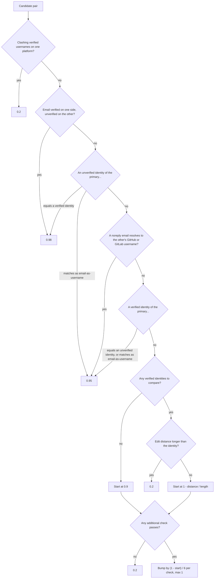
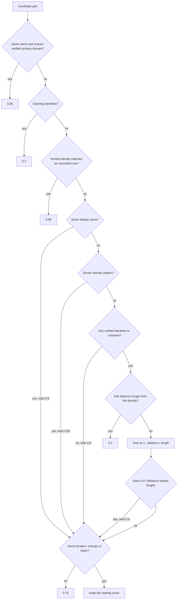

# merge_suggestions_worker

Generates member and organization merge suggestions and runs the LLM review of them. How this
worker fits into deduplication across CDP is in
[`docs/design/deduplication.md`](../../../docs/design/deduplication.md); the files, tables and
workflows are listed in
[`docs/knowledge/flow-deduplication.md`](../../../docs/knowledge/flow-deduplication.md).

## Scoring a member pair

`MemberSimilarityCalculator.calculateSimilarity` returns a score from 0 to 1. It checks the rules
in this order and returns at the first match. The fuzzy path at the end starts from the edit
distance between the closest pair of verified identities and only stays high if at least one
additional check passes.

The additional checks are: same location, roles in the same organization, shared languages,
shared programming languages, same timezone, and the same local part in git usernames on
unconfigured machines (`*.local`, `*.lan`). Git username clashes between two email-shaped values
do not count as a clash unless a display name is generic or a member is a bot. Cross-type
matching covers platforms that store emails as usernames: Git, Jira, Confluence and Gerrit.

## Scoring an organization pair

`OrganizationSimilarityCalculator.calculateSimilarity` checks the rules in this order and returns
at the first match. The identity checks run for each verified identity of the primary
organization in turn.

A starting score of 0 is replaced by 0.9 (`startingScore || HIGH_CONFIDENCE_SCORE`), so a pair
whose edit distance equals the identity length starts high, not low. The bump per passing check
is rounded down to 0, so a passing check keeps the starting score instead of raising it. A pair that passes no additional check scores exactly 0.75 whatever its
starting score: it lands in `organizationToMergeRaw` but not in `organizationToMerge`. A pair
with a low edit-distance score and a passing check keeps that low score, so it scores lower than
the same pair with no passing check.
