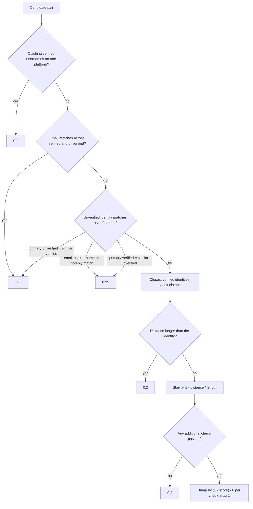
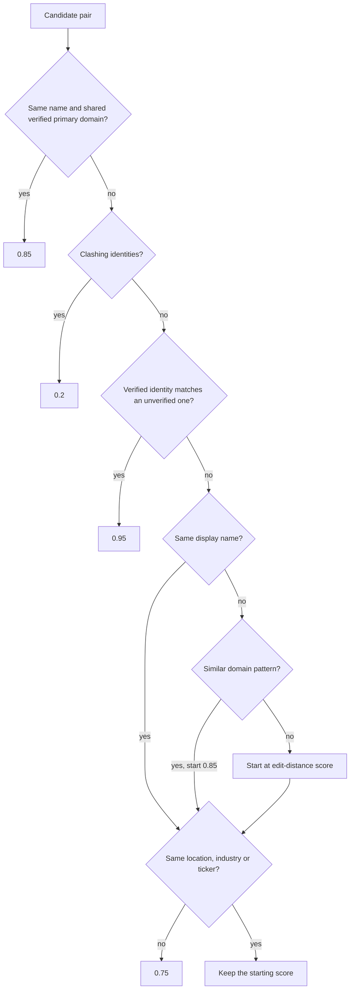

# merge_suggestions_worker

Generates member and organization merge suggestions and runs the LLM review of them. How this
worker fits into deduplication across CDP is in
[`docs/design/deduplication.md`](../../../docs/design/deduplication.md); the files, tables and
workflows are listed in
[`docs/knowledge/flow-deduplication.md`](../../../docs/knowledge/flow-deduplication.md).

## Scoring a member pair

`MemberSimilarityCalculator` returns a score from 0 to 1. The first rule that matches decides.
The fuzzy path starts from the edit distance between the closest pair of verified identities and
only stays high if at least one additional check passes.

The additional checks are: same location, roles in the same organization, shared languages,
shared programming languages, same timezone, and the same local part in git usernames on
unconfigured machines (`*.local`, `*.lan`). Git username clashes between two email-shaped values
do not count as a clash unless a display name is generic or a member is a bot. Cross-type
matching covers platforms that store emails as usernames: Git, Jira, Confluence and Gerrit.

## Scoring an organization pair

`OrganizationSimilarityCalculator` follows the same pattern with organization signals.

An organization pair that passes no additional check scores exactly 0.75, so it lands in
`organizationToMergeRaw` but not in `organizationToMerge`.
