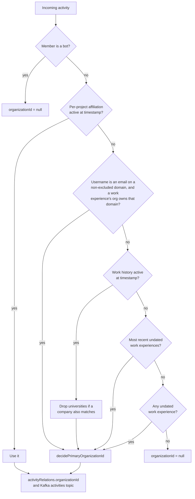
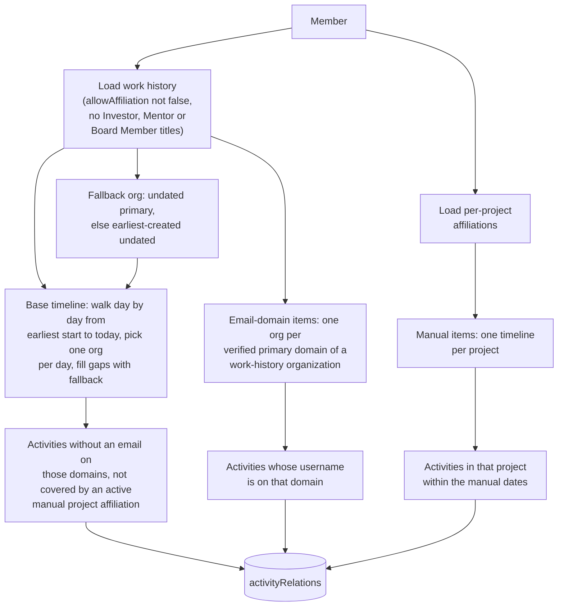
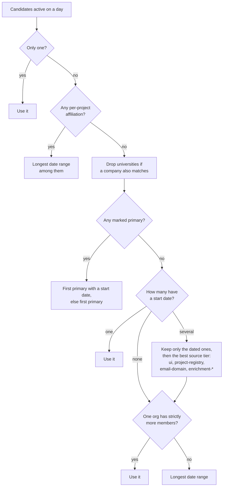

# Affiliation rules

How CDP picks the organization an activity is credited to. The same rules run in three places:
at ingest in `data_sink_worker`, in the recalculation in this module
(`refreshMemberOrganizationAffiliations`), and in the public affiliations API, which uses
`../affiliations/index.ts`. How those paths connect is in
[`docs/design/affiliation.md`](../../../../../docs/design/affiliation.md); where each piece lives is
in [`docs/knowledge/flow-affiliation.md`](../../../../../docs/knowledge/flow-affiliation.md).

## Resolution at ingest

`data_sink_worker` resolves the organization once per new activity and stores it with the
activity. Bot members get `null`.

`decidePrimaryOrganizationId` takes a single candidate as is; otherwise it prefers the one marked
primary, then the best `source` tier, then the organization with strictly more members, then the
longest date range.

## How a recalculation builds the timeline

`prepareMemberOrganizationAffiliationTimeline` produces three kinds of timeline items, each
limited to a disjoint slice of the member's activities.

When several candidates are active on the same day, the recalculation picks one like this:

## How the three paths differ

The three code paths share most of their selection order but not all of it:

| Step                                  | Ingest (`findAffiliation`) | Recalculation             | Public API                                |
| ------------------------------------- | -------------------------- | ------------------------- | ----------------------------------------- |
| Per-project affiliation wins          | Yes                        | Yes                       | Yes                                       |
| Email domain decides the organization | Yes                        | Yes                       | No                                        |
| Universities dropped for a company    | Date-matched step only     | Yes                       | No                                        |
| Member count for tie-break            | `organizationSegmentsAgg`  | `organizationSegmentsAgg` | Distinct members in `memberOrganizations` |
