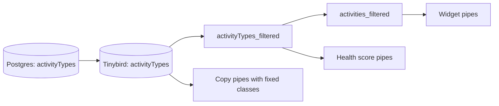

# Code contributions and collaborations

Insights metrics split activities into three classes: code contributions, collaborations, and
everything else. This doc covers where that classification lives and how the Tinybird pipes apply
it. The user-facing explanation of each metric lives with the Insights frontend docs.

## The `activityTypes` table

One row per `(activityType, platform)` pair in the Postgres table `activityTypes`:

| Column               | Meaning                                                       |
| -------------------- | ------------------------------------------------------------- |
| `activityType`       | Matches `activityRelations.type`, for example `issues-opened` |
| `platform`           | Matches `activityRelations.platform`, for example `github`    |
| `isCodeContribution` | The activity counts as a code contribution                    |
| `isCollaboration`    | The activity counts as a collaboration                        |
| `description`        | What the activity represents                                  |
| `label`              | Text the Insights UI shows for the type                       |

The two flags are independent. A row with both flags false is an "other" activity.

Examples from the initial seed: `authored-commit` on `git` and `pull_request-opened` on `github` are
code contributions; `issues-opened` and `issue-comment` on `github` are collaborations.

Rows come from Flyway migrations in `backend/src/database/migrations/`. The table and its first
rows are in `V1757490935__create_activityTypes_table.sql`; later migrations add rows when an
integration introduces new activity types. To classify a new type, add a migration that inserts
its row.

The match key is the `(type, platform)` pair. An activity whose pair has no row in
`activityTypes` drops out of every metric that filters through the table, including the "other"
class.

## How the table reaches Tinybird

The same migration adds `activityTypes` to the `sequin_pub` publication, so the table follows the
standard replication path (Postgres, Sequin, Kafka, Kafka Connect) into the Tinybird datasource
`datasources/activityTypes.datasource`. That datasource is a `ReplacingMergeTree` sorted by
`platform, activityType`, versioned by `updatedAt`. See [dataflow.md](./dataflow.md) and
[sequin.md](./sequin.md) for the path.

Metric pipes join on `activityTypes`. They do not read the `isContribution` column that
`activityRelations` carries.

## How pipes apply the classification

The metric pipes below read the cleaned buckets of the
[bucketing architecture](./bucketing-architecture.md), so bots and disabled or excluded
repositories are already gone before the classification applies.

### Caller-chosen classes: `activityTypes_filtered.pipe`

`pipes/activityTypes_filtered.pipe` returns the `(activityType, platform)` pairs that match three
boolean parameters:

| Parameter                   | Default | Selects rows where                                 |
| --------------------------- | ------- | -------------------------------------------------- |
| `includeCodeContributions`  | 1       | `isCodeContribution = 1`                           |
| `includeCollaborations`     | 0       | `isCollaboration = 1`                              |
| `includeOtherContributions` | 0       | `isCodeContribution = 0` and `isCollaboration = 0` |

The conditions combine with OR. With no parameters the pipe returns code contributions only; the
caller widens the set by passing the other flags.

Pipes that filter with `(type, platform) IN (SELECT activityType, platform FROM activityTypes_filtered)`
inherit these parameters from the request:

- `activities_filtered.pipe`, `activities_filtered_historical_cutoff.pipe` and
  `activities_filtered_retention.pipe`. The widget pipes built on `activities_filtered` are
  `active_contributors`, `active_organizations`, `active_days`, `activities_count`,
  `contributors_leaderboard`, `organizations_leaderboard`, `contributors_geo_distribution` and
  `organizations_geo_distribution`.
- The health score pipes that count contributors: `health_score_active_contributors`, `health_score_contributor_dependency`,
  `health_score_organization_dependency`, `health_score_retention`, and their `repo_health_score_*`
  counterparts.
- `cncf_country_activities.pipe` and `cncf_country_comparison.pipe`.

`activityTypes_by_project.pipe` takes the same three parameters and returns only the types that
have activities in the project or collection, with their `label`, for UI filter lists.

### Fixed classes in copy pipes

These pipes hard-code the classification in their SQL instead of taking parameters.

Code contributions or collaborations (`isCodeContribution = 1 OR isCollaboration = 1`):

| Pipe                                                                                    | Computes                                                                                     |
| --------------------------------------------------------------------------------------- | -------------------------------------------------------------------------------------------- |
| `segmentId_aggregates_snapshot`, `segmentId_aggregates_initial_snapshot`                | Distinct `contributorCount` and `organizationCount` per segment, into `segmentsAggregatedMV` |
| `collection_insights_aggregate_copy_pipe_0` to `_9`                                     | Unique contributors per collection, one pipe per collection bucket                           |
| `leaderboards_members`, `leaderboards_organizations`                                    | Activity count per member or organization, last 12 months against the 12 before              |
| `leaderboards_project_active_contributors`, `leaderboards_project_active_organizations` | Unique contributors or organizations per project, same two periods                           |
| `agentic_ai_momentum_glance_copy`, `agentic_ai_projects_list_copy`                      | Agentic AI collection metrics                                                                |

Code contributions only (`isCodeContribution`):

| Pipe                                         | Computes                                                       |
| -------------------------------------------- | -------------------------------------------------------------- |
| `org_page_kpis_copy_pipe`                    | Organization KPIs, including active contributors over 730 days |
| `org_page_projects_copy_pipe`                | Activity and contributor counts per organization and project   |
| `org_page_activities_timeseries_copy_pipe`   | Yearly code contribution counts per organization               |
| `org_page_contributors_timeseries_copy_pipe` | Yearly unique contributors per organization                    |

To change what a fixed-class metric counts, edit the `WHERE` clause in its pipe. To change which
activities fall in a class, change the `activityTypes` rows with a migration.
